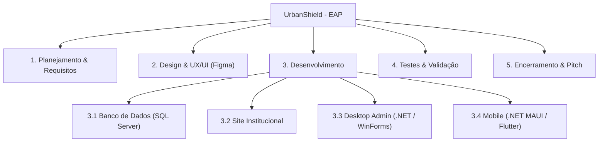
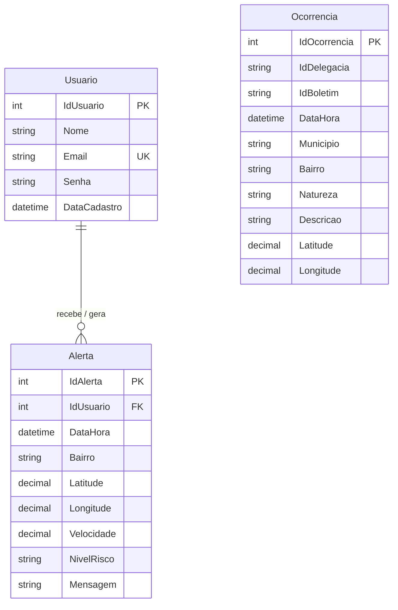
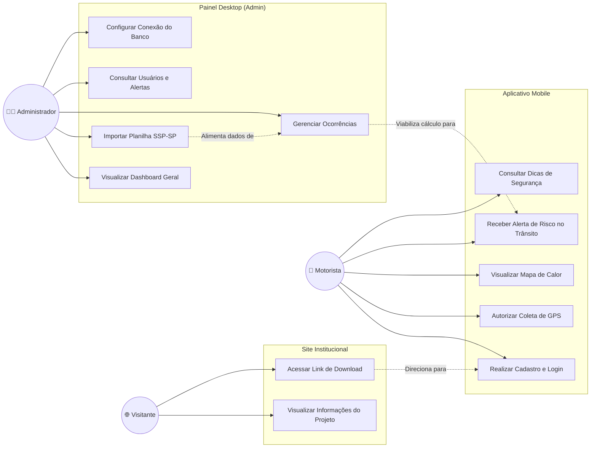
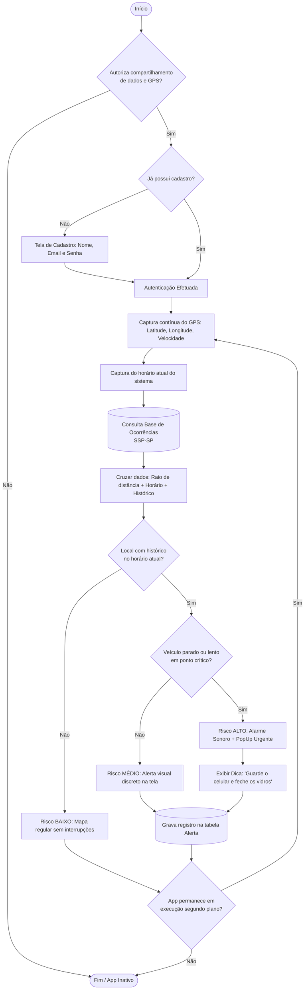

# UrbanShield

**Projeto Integrador — Documento de Definição do Projeto**  
**Aplicativo de Prevenção de Furtos no Trânsito Urbano**  
**Equipe EchoElite — Senac TDS**

---

## Briefing

### Missão

Prevenir e alertar usuários sobre áreas com risco de furto ou roubo em tempo real, permitindo que cada pessoa tome decisões mais seguras no dia a dia.

### Público-Alvo

O UrbanShield é voltado para motoristas e pessoas com acesso a tecnologia que usam o celular enquanto estão no trânsito de grandes cidades como São Paulo. São pessoas que, no dia a dia, passam por semáforos, congestionamentos e vias movimentadas sem saber quais locais possuem maior histórico de furtos naquele horário específico.

### Proposta de Valor

O UrbanShield ajuda motoristas a evitarem furtos através de alertas inteligentes baseados em localização, horário e histórico criminal oficial.

### Personas

**Persona 1 – Quem já foi vítima**  
Carlos tem 34 anos e trabalha como motorista de aplicativo nas noites de São Paulo. A rotina dele é o trânsito: cerca de 8 horas por dia rodando com o smartphone fixado no painel, acompanhando rotas. Numa quinta-feira, às 18h30, Carlos estava parado no semáforo da Avenida Paulista. Em fração de segundos, o vidro foi quebrado e seu celular levado. Carlos não tinha como saber que aquele ponto concentrava dezenas de ocorrências naquele exato horário.  
> *"Eu estava parado lá sem saber de nada. Se alguém tivesse me avisado, eu teria guardado o celular."*

**Persona 2 – Quem se preveniu**  
Joyce utiliza o carro diariamente para se deslocar ao trabalho pela Marginal Tietê no horário de pico. Ciente de assaltos recorrentes em congestionamentos, instalou o UrbanShield. Ao reduzir a velocidade próximo a um semáforo lento, o celular emitiu um aviso sonoro com alerta de risco alto: *"Área de alto risco de furto. Guarde o celular e seus pertences, mantenha os vidros fechados."* Joyce retirou imediatamente o telefone do suporte. Minutos depois, presenciou uma tentativa de abordagem no veículo ao lado.  
> *"O app avisou antes que eu percebesse o perigo. Guardei o celular e não aconteceu nada. Simples assim."*

---

## Sobre o Produto

O UrbanShield cruza em tempo real:
1. **Onde o motorista está agora** (coordenadas GPS)
2. **Que horas são** (janela temporal de risco)
3. **Histórico criminal do local** (dados oficiais da SSP-SP)
4. **Comportamento no trânsito** (parado no semáforo vs. em velocidade regular)

Diferente de mapas estáticos ou apps de trânsito comuns, o UrbanShield age preventivamente de forma proativa apenas quando a probabilidade de risco é real, sem sobrecarregar o motorista com notificações desnecessárias.

### Concorrência

| Aplicativo | Foco Principal | Limitação |
|---|---|---|
| Waze | Trânsito e acidentes | Avisos genéricos, sem foco específico em criminalidade |
| Google Maps | Navegação ponto a ponto | Sem integração com dados de segurança pública |
| SafeApp | Segurança urbana colaborativa | Baixa densidade de dados e atualizações manuais |
| **UrbanShield** | **Prevenção ativa de furtos** | **Especializado em dinâmica de trânsito e dados da SSP-SP** |

---

## Análise de Mercado

## Análise de Mercado
O mercado de segurança urbana digital está em crescimento acelerado no Brasil. Segundo o Fórum Brasileiro de Segurança Pública, o país registrou mais de 800 mil celulares roubados ou furtados em 2023, com concentração nas regiões metropolitanas. Só em São Paulo, a Secretaria de Segurança Pública (SSP-SP) registrou mais de 180 mil furtos de aparelhos celulares nesse mesmo período.

Esse cenário cria uma demanda real por soluções que vão além do que aplicativos de navegação já oferecem. O UrbanShield se posiciona no cruzamento entre três segmentos em expansão: aplicativos de segurança pessoal, mobilidade urbana e tecnologia para cidades inteligentes (Smart Cities). Esse último segmento tem atraído investimentos de prefeituras e empresas privadas, o que representa uma oportunidade de parceria e patrocínio para o projeto.

---

## Objetivos do Projeto

### Objetivo Geral

Desenvolver um ecossistema integrado (Mobile, Desktop e Web) capaz de alertar condutores em tempo real sobre áreas com incidência de roubos e furtos no trânsito urbano.

### Objetivos Específicos

- Monitorar coordenadas via GPS do dispositivo móvel continuamente.
- Processar cruzamento geográfico e temporal com a base da SSP-SP.
- Classificar risco nos níveis: **BAIXO**, **MEDIO** e **ALTO**.
- Emitir alertas sonoros e visuais em caso de risco iminente com o condutor parado ou em lentidão.
- Fornecer ferramenta Desktop administrativa para ingestão dos boletins da SSP-SP e gestão de métricas.
- Disponibilizar site institucional para divulgação e download da aplicação.

---
## Justificativa do Projeto
O número de furtos de celular no Brasil não para de crescer. De acordo com dados da SSP-SP disponíveis em base de dados oficial de SSP-SP, o estado de São Paulo registra dezenas de milhares de celulares subtraídos por mês, com concentração em horários e locais específicos — o que comprova que esses crimes seguem padrões identificáveis.

Apesar de existirem aplicativos de navegação como Waze e Google Maps, nenhum deles foi criado para prevenir furtos. Eles avisam sobre acidentes, buracos e radares, mas não informam ao motorista se ele está parado em um semáforo de uma rua com histórico de abordagem rápida naquele horário.

O UrbanShield nasce para preencher esse espaço. Usando dados públicos da Secretaria de Segurança Pública de São Paulo e a localização do próprio celular do usuário, o aplicativo transforma informação em prevenção — de forma simples, automática e acessível para qualquer pessoa que tenha um smartphone Android com acesso à internet.

## Definição do Problema
Motoristas com acesso a tecnologia que usam o celular no trânsito não têm como saber, naquele momento exato, se o local onde estão parados ou transitando tem alto risco de furto. As informações sobre criminalidade existem, mas estão espalhadas em relatórios difíceis de acessar e não chegam até o usuário de forma prática.

O resultado disso é que as pessoas se tornam vítimas sem ter tido nenhuma chance de se precaver. O UrbanShield resolve esse problema conectando os dados de ocorrências com a localização do usuário em tempo real, traduzindo tudo isso em um aviso simples e direto: *"Atenção você está em uma área de risco alto agora."*


---

## O Que o Aplicativo Precisa Fazer

### Requisitos Funcionais (RF)

| ID | Descrição |
|---|---|
| RF01 | Coletar coordenadas GPS continuamente no aplicativo mobile. |
| RF02 | Consultar a base de ocorrências filtrando por proximidade e janela de horário. |
| RF03 | Calcular o índice de perigo combinando local, horário e velocidade. |
| RF04 | Categorizar o perigo em níveis: BAIXO, MEDIO e ALTO. |
| RF05 | Disparar notificação visual e sonora em situações de risco ALTO. |
| RF06 | Apresentar mapa dinâmico com identificação visual dos locais de risco. |
| RF07 | Detectar se o condutor está parado (velocidade ≈ 0) em área vulnerável. |
| RF08 | Realizar checagens contínuas em segundo plano sem intervenção manual. |
| RF09 | Exibir recomendações rápidas de proteção ao motorista (ex: fechar vidros, ocultar aparelho). |
| RF10 | *(Desktop)* Importar planilhas oficiais de boletins da SSP-SP. |
| RF11 | *(Desktop)* Gerenciar CRUD de Ocorrências e Usuários. |
| RF12 | *(Desktop)* Exibir dashboard de monitoramento de alertas disparados. |

### Requisitos Não Funcionais (RNF)

| ID    | Descrição                                                                          |
| ----- | ---------------------------------------------------------------------------------- |
| RNF01 | Conexão com a internet (Wi-Fi ou dados móveis) no dispositivo Android.             |
| RNF02 | Permissão de acesso ao GPS de alta precisão ativada pelo usuário.                  |
| RNF03 | Armazenamento local de zonas de risco para tolerância à queda momentânea de sinal. |
| RNF04 | Interface móvel minimalista para evitar dispersão de atenção do motorista.         |
| RNF05 | Banco de dados relacional SQL Server com integridade referencial.                  |

| ID        | Requisito                                                                                                                                                  |
| :-------- | :--------------------------------------------------------------------------------------------------------------------------------------------------------- |
| **RNF01** | Um smartphone Android com acesso à internet (wi-fi ou dados móveis), para que o app receba as informações atualizadas sobre as áreas de risco.             |
| **RNF02** | Permissão de acesso ao GPS de alta precisão ativada pelo usuário.                                                                                          |
| **RNF03** | Espaço disponível na memória do celular, para guardar os mapas de risco e funcionar mesmo sem internet em momentos de queda de sinal.                      |
| **RNF04** | Sistema operacional Android (versão inicial)                                                                                                               |
| **RNF05** | Uma tela que permita ler facilmente as notificações, pois a interface foi pensada para ser simples e direta para evitar dispersão de atenção do motorista. |
| **RNF06** | Velocidade de processamento básica — funciona até em aparelhos mais simples.                                                                               |
| RNF07     | Banco de dados relacional SQL Server com integridade referencial.                                                                                          |

---

## O Que Está Incluído no Projeto

- **Mobile:** App Android focado no motorista em trânsito com GPS e avisos em tempo real.
	Nesta primeira versão, o UrbanShield irá conter:
- Análise automática do risco com base no local, no horário e no histórico de crimes.
- Avisos sonoros e visuais quando o usuário entrar em área de risco alto.
- Mapa interativo com as regiões de risco destacadas por cores.
- Banco de dados com histórico de furtos e roubos extraído das planilhas públicas da SSP-SP, será atualizado vip API através do link pelo site da SSP disponíveis em base de dados oficial de SSP-SP.

- **Desktop:** Software administrativo com controle de ocorrências, importação da SSP-SP e métricas.
- **Site:** Pagina institucional para apresentação pública do produto e link de download do aplicativo.
- **Banco de Dados:** Modelagem relacional unificada em SQL Server.

---

## Como o Aplicativo Funciona
O funcionamento do UrbanShield pode ser dividido em três partes: o que ele recebe, o que ele processa e o que ele mostra para o usuário.

### O Que o Aplicativo Recebe
A cada atualização, o aplicativo coleta automaticamente:
- A localização exata do usuário, fornecida pelo GPS do celular.
- O horário atual do sistema.
- A velocidade aproximada do deslocamento (se está parado, lento ou em movimento).
- Os registros históricos de crimes da região, vindos dos dados da SSP-SP.

### O Que o Aplicativo Analisa
Com essas informações, o aplicativo verifica se aquela região tem histórico de crimes, se o horário atual coincide com os horários de maior risco e se o usuário está parado ou em movimento lento, situação que aumenta a vulnerabilidade. Com base nessa análise, o sistema define o nível de risco.

### O Que o Usuário Recebe
Dependendo do que foi analisado, o usuário recebe um dos seguintes retornos:

| Situação Analisada | Retorno no Dispositivo |
|---|---|
| Região sem histórico criminal relevante | Mapa limpo, em segundo plano e sem alertas |
| Região com ocorrências, fora do horário de pico | Aviso discreto em tela (sem emissão sonora) |
| Região de risco no horário de pico, trânsito fluido | Alerta visual moderado de atenção |
| Região com alto índice, horário de pico e veículo parado/lento | **Alerta sonoro contundente + mensagem visual com instruções** |

---

## Metas do Projeto — Matriz SMART

| Critério | Descrição |
|---|---|
| S — Específico | Desenvolver um MVP funcional e validá-lo com pelo menos 30 usuários durante o projeto |
| M — Mensurável | Acompanhar o número de usuários cadastrados, os alertas emitidos e a avaliação do app nas lojas digitais, com meta de manter nota acima de 4 estrelas |
| A — Atingível | Utilizar dados gratuitos e públicos da SSP-SP, o GPS padrão dos celulares Android e ferramentas de desenvolvimento gratuitas, sem necessidade de grandes investimentos iniciais |
| R — Relevante | Reduzir a sensação de insegurança dos usuários no trânsito, contribuindo para que menos pessoas sejam pegas de surpresa em situações de risco |
| T — Temporal | Versão funcional em até 12 meses. Meta principal: 5.000 usuários ativos e mais de 2.000 horas de uso nos primeiros 6 meses após o lançamento |

**Meta principal resumida:** "Alcançar 5.000 usuários ativos e gerar mais de 2.000 horas de uso nos primeiros 6 meses após o lançamento."

---

## Cronograma e EAP



---
## Quem Está Envolvido no Projeto

Stakeholders são todas as pessoas ou grupos que têm alguma relação com o projeto — seja porque serão afetados por ele, porque contribuem com algo ou porque têm interesse no resultado.

| Quem                                                      | Papel no Projeto                                                                     |
| --------------------------------------------------------- | ------------------------------------------------------------------------------------ |
| Usuários do aplicativo                                    | As pessoas que vão usar o app no dia a dia para se proteger de furtos no trânsito    |
| Equipe EchoElite                                          | Os alunos responsáveis por criar, desenvolver e apresentar o projeto                 |
| SSP-SP (Secretaria de Segurança Pública)                  | Fornece os dados públicos de ocorrências que alimentam o banco de informações do app |
| Empresas de mobilidade (Uber, 99, Waze)                   | Possíveis parceiros estratégicos que poderiam integrar ou patrocinar a solução       |
| (**Poderá estar envolvido**)Prefeituras e órgãos públicos | Potenciais investidores dentro do conceito de Cidades Inteligentes (Smart Cities)    |


---
## Banco de Dados

A arquitetura do banco foi consolidada em **3 tabelas**, unificando as coordenadas diretamente nas entidades de evento (`Ocorrencia` e `Alerta`), eliminando redundâncias e acelerando as consultas do sistema.

### DDL — SQL Server

```sql
CREATE DATABASE UrbanShield;
GO

USE UrbanShield;
GO

-- 1. USUARIO
CREATE TABLE Usuario (
    IdUsuario INT IDENTITY(1,1) PRIMARY KEY,
    Nome NVARCHAR(100) NOT NULL,
    Email NVARCHAR(150) NOT NULL UNIQUE,
    Senha NVARCHAR(255) NOT NULL,
    DataCadastro DATETIME2 NOT NULL DEFAULT GETDATE()
);
GO

-- 2. OCORRENCIA (Dados SSP-SP)
CREATE TABLE Ocorrencia (
    IdOcorrencia INT IDENTITY(1,1) PRIMARY KEY,
    IdDelegacia NVARCHAR(50),
    IdBoletim NVARCHAR(50) NOT NULL,            
    DataHora DATETIME2 NOT NULL,
    Municipio NVARCHAR(100) NOT NULL,           
    Bairro NVARCHAR(100) NOT NULL,             
    Natureza NVARCHAR(150) NOT NULL,           
    Descricao NVARCHAR(500),
    Latitude DECIMAL(9,6) NOT NULL,
    Longitude DECIMAL(9,6) NOT NULL
);
GO

-- 3. ALERTA (Registro de notificações emitidas aos motoristas)
CREATE TABLE Alerta (
    IdAlerta INT IDENTITY(1,1) PRIMARY KEY,
    IdUsuario INT NOT NULL,
    DataHora DATETIME2 NOT NULL DEFAULT GETDATE(),
    Bairro NVARCHAR(100) NOT NULL,              
    Latitude DECIMAL(9,6) NOT NULL,
    Longitude DECIMAL(9,6) NOT NULL,
    Velocidade DECIMAL(5,2),
    NivelRisco NVARCHAR(20) NOT NULL,          
    Mensagem NVARCHAR(500),
    CONSTRAINT FK_Alerta_Usuario
        FOREIGN KEY (IdUsuario)
        REFERENCES Usuario(IdUsuario),
    CONSTRAINT CK_Alerta_NivelRisco
        CHECK (NivelRisco IN ('BAIXO', 'MEDIO', 'ALTO'))
);
GO
```

### Diagrama de Entidade-Relacionamento (ER)

Representação fiel da modelagem do projeto:



### Matriz de Uso do Banco por Plataforma

| Tabela | Site | Desktop (Admin) | Mobile (App) |
|---|:---:|:---:|:---:|
| `Usuario` | — | Leitura e Exclusão | Cadastro, Autenticação e Perfil |
| `Ocorrencia` | — | Importação (Excel), CRUD completo | Leitura / Cruzamento em tempo real |
| `Alerta` | — | Visualização analítica no Dashboard | Gravação ao disparar alerta no celular |

---

## Plataforma 1 — Site Institucional

[Figma](https://www.figma.com/proto/EGBKHJMd8Di60CUzVwm5gL/UrbanShield-Site---Prot%C3%B3tipo?node-id=2-42&starting-point-node-id=2%3A42&t=4IlYQxXA19T2VLAH-1)

- **Objetivo:** Pagina oficial voltada à conscientização, apresentação dos diferenciais e disponibilização do instalador do aplicativo.
- **Público:** Condutores, parceiros, avaliadores acadêmicos e público em geral.
- **Seções:**
  1. *Hero*: Proposta de valor com chamada para ação (*Download do App*).
  2. *Como Funciona*: Explicação visual do cruzamento de dados.
  3. *Personas*: Depoimentos baseados nos casos de Carlos e Joyce.
  4. *Estatísticas*: Painel estático ilustrando índices de furtos em SP.
  5. *Equipe EchoElite*: Apresentação dos integrantes do projeto Senac TDS.
- **Tecnologias:** HTML5, CSS3 moderno, JavaScript puro; hospedagem no GitHub Pages.(Pesquisa)

---

## Plataforma 2 — Desktop (Painel Administrativo)

[Figma](https://www.figma.com/design/uZOBPGSZWZwiu4L65gXG0V/UrbanShield-Desktop--Prot%C3%B3tipo?node-id=0-1&t=KtFH6jwPXIlFY8tK-1)

- **Objetivo:** Retaguarda operacional do sistema. É onde os dados oficiais da SSP-SP são processados e onde a saúde dos alertas é fiscalizada.
- **Público:** Administradores do sistema (equipe técnica).
- **Módulos Principais:**
  - **Dashboard:** Contadores (`TotalUsuarios`, `TotalOcorrencias`, `AlertasHoje`) e gráfico de risco.
  - **Módulo de Ocorrências:** Leitura de planilhas Excel da SSP-SP e inserção em lote na tabela `Ocorrencia`.
  - **Módulo de Usuários:** Consulta de contas cadastradas e acompanhamento de alertas vinculados.
  - **Módulo de Alertas:** Histórico de avisos disparados aos motoristas no trânsito.
- **Tecnologia recomendada:** Windows Forms (.NET) com ADO.NET para conexão com o SQL Server.(Pesquisa inicial)

---

## Plataforma 3 — Mobile (App do Motorista)
[Figma](https://www.figma.com/design/dV9VL4FQ4C8dYPwDGQeZA5/UrbanShield-Mobile---Prot%C3%B3tipo?t=KtFH6jwPXIlFY8tK-1)

- **Objetivo:** Execução contínua em segundo plano enquanto o motorista conduz, emitindo avisos pontuais e assertivos.
- **Público:** Motoristas particulares e de aplicativo (Uber, 99, táxi).
- **Funcionalidades:**
  - Login e autenticação com armazenamento seguro de credenciais.
  - Leitura constante de coordenadas geográficas e velocidade instantânea.
  - Algoritmo de cálculo de risco baseado na proximidade de ocorrências e horário.
  - Alerta sonoro e visual prioritário em situação de risco ALTO com condutor vulnerável.
- **Tecnologia recomendada:** .NET MAUI ou Flutter ou React Native para plataforma Android.(Pesquisa Inicial)

---

## Diagramas do Sistema

### 1. Diagrama de Casos de Uso (Geral)

Mapeamento de interações entre os atores (**Visitante**, **Motorista** e **Administrador**):



### 2. Fluxograma Completo de Execução

Representação ponta a ponta desde o cadastro até a tomada de decisão do algoritmo de risco:



---

## Próximos Passos e Expansões Futuras

- Algoritmos preditivos de mancha criminal com aprendizado de máquina.
- Relatos colaborativos de incidentes validados pela comunidade de condutores.
- Integração e portabilidade para ecossistema Apple (iOS / CarPlay / Android Auto).
- Parcerias estratégicas com seguradoras e empresas de mobilidade urbana (Uber, 99).
  
  
  
 Riscos do Projeto e Como Evitá-los
Todo projeto tem riscos — situações que podem dar errado e atrasar ou prejudicar o resultado. Identificamos os principais abaixo, junto com o que faremos para evitá-los ou reduzir o impacto:

| O que pode dar errado                                  | Probabilidade | Impacto | O que faremos se acontecer                                                               |
| :----------------------------------------------------- | :------------ | :------ | :--------------------------------------------------------------------------------------- |
| **Dados da SSP-SP desatualizados ou indisponíveis**    | Média         | Alto    | Manter e buscar auto atualização e monitor update via Desktop                            |
| **Queda de internet durante o uso**                    | Alta          | Alto    | Salvar os mapas de risco no próprio celular para funcionar offline.                      |
| **GPS impreciso (dentro de túneis ou prédios)**        | Média         | Médio   | Usar a última localização conhecida e uma margem de área ao redor.                       |
| **Poucos usuários nos primeiros meses**                | Média         | Médio   | Divulgar o app por meio de parcerias com faculdades e grupos de motoristas.              |
| **Dificuldade de acessar dados públicos de segurança** | Média         | Alto    | Usar arquivos locais como alternativa enquanto as fontes externas não estão disponíveis. |

---

## Estimativa de Orçamento
Para que o projeto seja viável, é importante estimar os custos envolvidos. Por ser um projeto acadêmico desenvolvido por alunos, a maioria das ferramentas utilizadas é gratuita. Ainda assim, alguns custos podem surgir ao longo do desenvolvimento:

| Pesquisa de Itens                                  | Tipo                             | Custo Estimado                |
| :------------------------------------------------- | :------------------------------- | :---------------------------- |
| **SQLServer (banco de dados e autenticação)**      | Gratuito na versão básica        | R$ 0,00                       |
| **Google Maps API (mapas e geolocalização)**       | Gratuito até certo volume de uso | R$ 0,00 — R$ 200,00/mês       |
| **Publicação na Google Play Store**                | Taxa única                       | R$ 125,00 (aprox. US$ 25)     |
| **Ferramentas de desenvolvimento (VS Code)         | Gratuitas                        | R$ 0,00                       |
| **Design de interface (Figma)**                    | Gratuito para equipes pequenas   | R$ 0,00                       |
| **Hospedagem (Github) e servidor (se necessário)** | Variável                         | R$ 0,00 — R$ 150,00/mês       |
| **Total estimado (fase inicial)**                  |                                  | **R$ 125,00 a R$ 475,00/mês** |

*Vale destacar que o uso dos dados da SSP-SP é gratuito e público, o que elimina o custo de compra de base de dados — uma das maiores vantagens competitivas do projeto.*

---

## Quando o Projeto Estará Pronto

Para considerar o aplicativo pronto para uso, ele precisará atender aos seguintes critérios:
- Emitir avisos em tempo real quando o usuário entrar em área de risco alto.
- Mostrar o mapa com as regiões perigosas corretamente identificadas por nível de risco.
- Atualizar as informações automaticamente, sem que o usuário precise fazer nada.
- Exibir o nível de risco de forma clara e fácil de entender na tela.
- Tocar um aviso sonoro e exibir uma mensagem visível nos casos de risco alto.
- Funcionar em celulares Android com GPS e internet.

---

## Tecnologias Utilizadas
Abaixo estão as ferramentas e tecnologias que serão usadas para construir o UrbanShield. Todas são amplamente utilizadas no mercado e compatíveis com o nível de desenvolvimento da equipe:

| Para que serve                                    | Ferramenta escolhida                        |
| :------------------------------------------------ | :------------------------------------------ |
| Criar as telas do aplicativo (o que o usuário vê) | Linguagem ou app de FrontEnd                |
| Guardar os dados dos usuários e das ocorrências   | SQL Server(Ferramenta institucional Senac)  |
| Mostrar o mapa e calcular a localização           | API Mapa + GPS do celular                   |
| Obter os dados de crimes de São Paulo             | Planilhas públicas da SSP-SP (link oficial) |
| Enviar alertas e atualizações em tempo real       | Via Notificação ou PopUp                    |


---

## Por Que o UrbanShield é Diferente

> *"O UrbanShield não apenas aponta onde há crimes: ele analisa quando, onde e em qual velocidade o motorista se encontra para protegê-lo antes da abordagem criminosa."*

O sistema atua com precisão cirúrgica no momento em que o condutor está mais frágil — parado em semáforos ou lentidões de vias expressas com aparelho à mostra —, unindo dados governamentais com geolocalização ativa para salvar bens e vidas.
