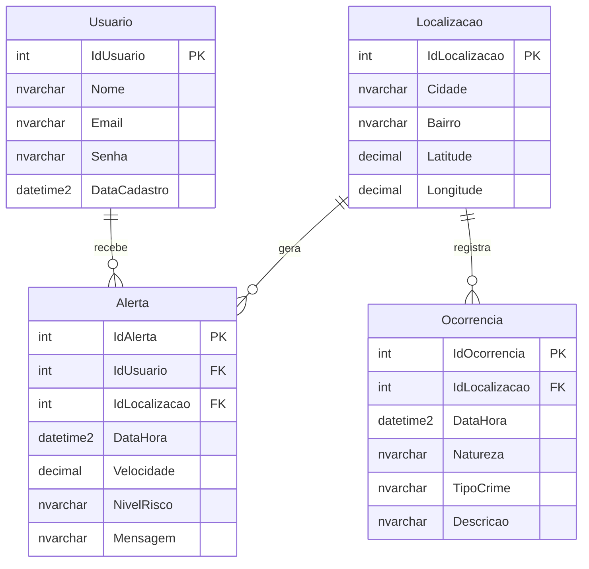
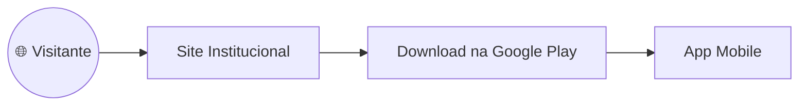
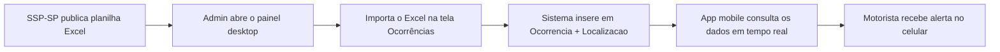
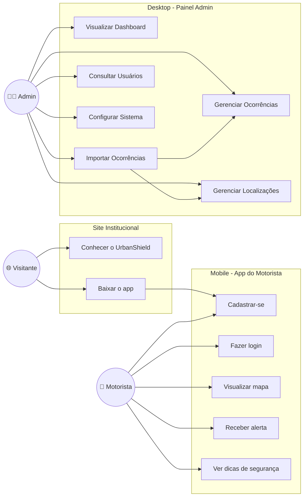
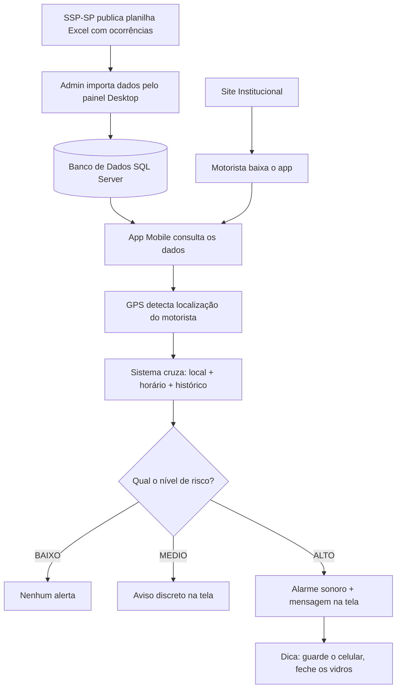

# UrbanShield

**Projeto Integrador — Documento de Definição do Projeto**
**Aplicativo de Prevenção de Furtos no Trânsito Urbano**
**Equipe EchoElite — Senac TDS**

---

## Sumário

1. [Briefing](#briefing)
2. [Sobre o Produto](#sobre-o-produto)
3. [Análise de Mercado](#análise-de-mercado)
4. [Objetivos do Projeto](#objetivos-do-projeto)
5. [Justificativa do Projeto](#justificativa-do-projeto)
6. [Definição do Problema](#definição-do-problema)
7. [Requisitos do Aplicativo](#o-que-o-aplicativo-precisa-fazer)
8. [Escopo do Projeto](#o-que-está-incluído-no-projeto)
9. [Como o Aplicativo Funciona](#como-o-aplicativo-funciona)
10. [Metas SMART](#metas-do-projeto--matriz-smart)
11. [Cronograma](#cronograma)
12. [Stakeholders](#quem-está-envolvido-no-projeto)
13. [Riscos](#riscos-do-projeto-e-como-evitá-los)
14. [Orçamento](#estimativa-de-orçamento)
15. [Critérios de Entrega](#quando-o-projeto-estará-pronto)
16. [Tecnologias Utilizadas](#tecnologias-utilizadas)
17. [EAP](#eap--estrutura-do-projeto-por-etapas)
18. [Banco de Dados](#banco-de-dados)
19. [Plataforma 1 — Site](#plataforma-1--site-institucional)
20. [Plataforma 2 — Desktop](#plataforma-2--desktop-painel-admin)
21. [Plataforma 3 — Mobile](#plataforma-3--mobile-app-do-motorista)
22. [Diagramas](#diagramas)
23. [Expansões Futuras](#próximos-passos-e-expansões-futuras)
24. [Por Que o UrbanShield é Diferente](#por-que-o-urbanshield-é-diferente)

---

## Briefing

### Missão

Prevenir e alertar usuários sobre áreas com risco de furto ou roubo em tempo real, permitindo que cada pessoa tome decisões mais seguras no dia a dia.

### Público-Alvo

O UrbanShield é voltado para motoristas e pessoas com acesso a tecnologia que usam o celular enquanto estão no trânsito de grandes cidades como São Paulo. São pessoas que, no dia a dia, passam por semáforos, congestionamentos e ruas movimentadas sem saber quais locais têm maior risco de furto naquele horário.

### Proposta de Valor

O UrbanShield ajuda motoristas a evitarem furtos através de alertas inteligentes baseados em localização, horário e histórico criminal.

### Personas

**Persona 1 – Quem já foi vítima**

Para entender melhor quem usa o aplicativo, criamos uma persona: Carlos tem 34 anos e rala como motorista de app nas noites de São Paulo. A vida dele é o trânsito: são umas 8 horas por dia rodando com o celular no painel, grudado no GPS para pegar as corridas.

Era uma quinta-feira, 18h30. Carlos estava parado no semáforo da Avenida Paulista com o celular na mão. Em segundos, um homem bateu no vidro e levou o aparelho. Ele não tinha como saber que aquele cruzamento registrava mais de 40 furtos por mês naquele horário. Nenhum app avisou. Nenhuma notificação chegou.

Após o ocorrido e a compra de um novo aparelho, ele descobriu o aplicativo UrbanShield, com avaliações boas sobre alerta de furtos durante o trânsito. As palavras dele antes de navegar com o app são:

> "Eu estava parado lá sem saber de nada. Se alguém tivesse me avisado, eu teria guardado o celular."

**Persona 2 – Quem se preveniu**

Joyce depende do carro diariamente para o trajeto de ida e volta do trabalho. Sua rota principal inclui a Marginal Tietê, que ela costuma atravessar exatamente no horário de pico, um cenário marcado pelo trânsito lento e por uma maior vulnerabilidade a furtos rápidos.

Como muitos motoristas, ela sempre mantém o celular no suporte do painel para acompanhar o trajeto. Porém, após um colega de trabalho ser assaltado no trânsito nessas mesmas condições, o alerta acendeu. Buscando uma forma de se prevenir, ela baixou o UrbanShield. Quando ao diminuir a velocidade em horário de pico devido a trânsito lento de um dia típico o celular apitou e mostrou o alerta:

> "Área de alto risco de furto. Guarde o celular e seus pertences, mantenha os vidros fechados."

Sem hesitar, ela retirou o aparelho do suporte e o escondeu. Apenas dois minutos depois do aviso, a ameaça se confirmou: Joyce presenciou um homem tentando abordar o veículo que estava logo ao lado do seu. Após o acontecimento a frase da Joyce foi o seguinte:

> "O app avisou antes que eu percebesse o perigo. Guardei o celular e não aconteceu nada. Simples assim."

---

## Sobre o Produto

O UrbanShield é um aplicativo para celular que avisa o usuário quando ele está passando por uma área com histórico de furtos e roubos. Ele faz isso cruzando três informações: onde o usuário está agora, que horas são e o que aconteceu naquele local no passado. Com esses dados, o app calcula se o risco está baixo, médio ou alto e manda um aviso sonoro ou visual para a tela do celular.

O diferencial do UrbanShield é que ele não mostra apenas um mapa estático com pontos perigosos — ele analisa o momento atual e avisa somente quando faz sentido, evitando notificações desnecessárias.

### Concorrência

| Aplicativo | Foco Principal | Limitação |
|---|---|---|
| Waze | Trânsito e acidentes | Não foca em crimes, avisos genéricos |
| Google Maps | Navegação geral | Sem dados de segurança criminal |
| SafeApp | Segurança urbana | Pouca cobertura e dados desatualizados |
| **UrbanShield** | **Prevenção de furtos** | **Foco exclusivo em criminalidade, com análise por horário** |

---

## Análise de Mercado

O mercado de segurança urbana digital está em crescimento acelerado no Brasil. Segundo o Fórum Brasileiro de Segurança Pública, o país registrou mais de 800 mil celulares roubados ou furtados em 2023, com concentração nas regiões metropolitanas. Só em São Paulo, a Secretaria de Segurança Pública (SSP-SP) registrou mais de 180 mil furtos de aparelhos celulares nesse mesmo período.

Esse cenário cria uma demanda real por soluções que vão além do que aplicativos de navegação já oferecem. O UrbanShield se posiciona no cruzamento entre três segmentos em expansão: aplicativos de segurança pessoal, mobilidade urbana e tecnologia para cidades inteligentes (Smart Cities). Esse último segmento tem atraído investimentos de prefeituras e empresas privadas, o que representa uma oportunidade de parceria e patrocínio para o projeto.

---

## Objetivos do Projeto

### Objetivo Geral

Criar um aplicativo para celular que avise os usuários, em tempo real, quando estiverem passando por regiões com alto índice de furtos e roubos, ajudando a reduzir a chance de vitimização no trânsito urbano.

### Objetivos Específicos

- Usar o GPS do celular para saber onde o usuário está a todo momento
- Verificar, em tempo real, se aquela região tem histórico de crimes no horário atual
- Calcular se o risco é baixo, médio, alto ou extremo e exibir isso de forma clara
- Emitir um aviso sonoro e uma mensagem na tela quando o risco for alto
- Mostrar um mapa com as áreas mais perigosas destacadas por cor
- Dar dicas de proteção ao usuário, como guardar o celular ou fechar os vidros do carro

---

## Justificativa do Projeto

O número de furtos de celular no Brasil não para de crescer. De acordo com dados da SSP-SP disponíveis na [base de dados oficial da SSP-SP](https://www.ssp.sp.gov.br/assets/estatistica/transparencia/baseDados/celularesSub/CelularesSubtraidos_2026.xlsx), o estado de São Paulo registra dezenas de milhares de celulares subtraídos por mês, com concentração em horários e locais específicos — o que comprova que esses crimes seguem padrões identificáveis.

Apesar de existirem aplicativos de navegação como Waze e Google Maps, nenhum deles foi criado para prevenir furtos. Eles avisam sobre acidentes, buracos e radares, mas não informam ao motorista se ele está parado em um semáforo de uma rua com histórico de abordagem rápida naquele horário.

O UrbanShield nasce para preencher esse espaço. Usando dados públicos da Secretaria de Segurança Pública de São Paulo e a localização do próprio celular do usuário, o aplicativo transforma informação em prevenção — de forma simples, automática e acessível para qualquer pessoa que tenha um smartphone Android com acesso à internet.

---

## Definição do Problema

Motoristas com acesso a tecnologia que usam o celular no trânsito não têm como saber, naquele momento exato, se o local onde estão parados ou transitando tem alto risco de furto. As informações sobre criminalidade existem, mas estão espalhadas em relatórios difíceis de acessar e não chegam até o usuário de forma prática.

O resultado disso é que as pessoas se tornam vítimas sem ter tido nenhuma chance de se precaver. O UrbanShield resolve esse problema conectando os dados de ocorrências com a localização do usuário em tempo real, traduzindo tudo isso em um aviso simples e direto: "Atenção — você está em uma área de risco alto agora."

---

## O Que o Aplicativo Precisa Fazer

### Funções Principais (Requisitos Funcionais)

| ID | O que o aplicativo faz |
|---|---|
| RF01 | Saber onde o usuário está usando o GPS do próprio celular, atualizando a localização a todo momento |
| RF02 | Consultar o histórico de crimes registrados naquela região e naquele horário, usando dados da SSP-SP |
| RF03 | Comparar a localização atual, o horário e o histórico de crimes para entender o nível de perigo |
| RF04 | Definir se o risco é baixo, médio, alto ou extremo e mostrar isso para o usuário na tela |
| RF05 | Emitir um aviso sonoro e uma mensagem visível na tela quando o risco for alto |
| RF06 | Exibir um mapa com as áreas perigosas destacadas por cores diferentes conforme o nível de risco |
| RF07 | Perceber se o veículo está parado ou em movimento lento, o que aumenta o risco de abordagem |
| RF08 | Repetir esse processo automaticamente, sem que o usuário precise fazer nada |
| RF09 | Dar dicas de segurança ao usuário, como guardar o celular ou fechar os vidros do carro |

### Requisitos Não Funcionais

| ID | Requisito |
|---|---|
| RNF01 | Um smartphone Android com acesso à internet (wi-fi ou dados móveis), para que o app receba as informações atualizadas sobre as áreas de risco |
| RNF02 | O GPS do celular ativado, para que o aplicativo saiba onde o usuário está |
| RNF03 | Espaço disponível na memória do celular, para guardar os mapas de risco e funcionar mesmo sem internet em momentos de queda de sinal |
| RNF04 | Sistema operacional Android (versão inicial) — a versão para iPhone está prevista para uma etapa futura do projeto |
| RNF05 | Uma tela que permita ler facilmente as notificações, pois a interface foi pensada para ser simples e direta |
| RNF06 | Velocidade de processamento básica — funciona até em aparelhos mais simples |

---

## O Que Está Incluído no Projeto

### O Que Será Desenvolvido

Nesta primeira versão, o UrbanShield irá conter:

- Monitoramento de localização em tempo real usando o GPS do celular
- Análise automática do risco com base no local, no horário e no histórico de crimes
- Avisos sonoros e visuais quando o usuário entrar em área de risco alto
- Mapa interativo com as regiões de risco destacadas por cores
- Banco de dados com histórico de furtos e roubos extraído das planilhas públicas da SSP-SP, atualizado via API através do [link oficial da SSP-SP](https://www.ssp.sp.gov.br/assets/estatistica/transparencia/baseDados/celularesSub/CelularesSubtraidos_2026.xlsx)
- Versão para celulares Android
- **Site institucional** para apresentação e download do app
- **Painel desktop administrativo** para operação e monitoramento do sistema

### O Que Não Fará Parte Desta Versão

- Integração direta com a polícia ou com a central 190
- Rastreamento de celulares já furtados
- Câmeras ou monitoramento por vídeo
- Versão para iPhone (iOS) — prevista para uma etapa futura
- Central de atendimento com pessoas físicas

---

## Como o Aplicativo Funciona

O funcionamento do UrbanShield pode ser dividido em três partes: o que ele recebe, o que ele processa e o que ele mostra para o usuário.

### O Que o Aplicativo Recebe

A cada atualização, o aplicativo coleta automaticamente:

- A localização exata do usuário, fornecida pelo GPS do celular
- O horário atual do sistema
- A velocidade aproximada do deslocamento (se está parado, lento ou em movimento)
- Os registros históricos de crimes da região, vindos dos dados da SSP-SP

### O Que o Aplicativo Analisa

Com essas informações, o aplicativo verifica se aquela região tem histórico de crimes, se o horário atual coincide com os horários de maior risco e se o usuário está parado ou em movimento lento — situação que aumenta a vulnerabilidade. Com base nessa análise, o sistema define o nível de risco.

### O Que o Usuário Recebe

| Situação | O que o app mostra |
|---|---|
| Região sem histórico de crimes | Nada, o mapa fica limpo, sem alertas |
| Região com crimes, mas fora do horário de risco | Aviso discreto na tela, sem som |
| Região com crimes no horário de risco, usuário em movimento | Mensagem de atenção moderada na tela |
| Região com crimes, horário de risco e usuário parado | Alarme sonoro + mensagem de alerta na tela |

---

## Metas do Projeto — Matriz SMART

| Critério | Descrição |
|---|---|
| S — Específico | Desenvolver um MVP funcional e validá-lo com pelo menos 30 usuários durante o projeto |
| M — Mensurável | Acompanhar o número de usuários cadastrados, os alertas emitidos e a avaliação do app nas lojas digitais, com meta de manter nota acima de 4 estrelas |
| A — Atingível | Utilizar dados gratuitos e públicos da SSP-SP, o GPS padrão dos celulares Android e ferramentas de desenvolvimento gratuitas, sem necessidade de grandes investimentos iniciais |
| R — Relevante | Reduzir a sensação de insegurança dos usuários no trânsito, contribuindo para que menos pessoas sejam pegas de surpresa em situações de risco |
| T — Temporal | Versão funcional em até 12 meses. Meta principal: 5.000 usuários ativos e mais de 2.000 horas de uso nos primeiros 6 meses após o lançamento |

**Meta principal resumida:** "Alcançar 5.000 usuários ativos e gerar mais de 2.000 horas de uso nos primeiros 6 meses após o lançamento."

---

## Cronograma

| Período | O que será feito |
|---|---|
| 1º Mês | Coleta e organização dos dados históricos da SSP-SP. Definição dos requisitos, escopo e layout do aplicativo |
| 2º Mês | Desenvolvimento do backend — a parte do sistema que processa os dados e calcula o risco |
| 3º Mês | Desenvolvimento do frontend — a tela que o usuário vê, com o mapa, avisos e notificações |
| 4º ao 12º Mês | Testes com usuários reais (motoristas), ajustes, divulgação do app, coleta de feedback e pitch acadêmico final |

---

## Quem Está Envolvido no Projeto

Stakeholders são todas as pessoas ou grupos que têm alguma relação com o projeto — seja porque serão afetados por ele, porque contribuem com algo ou porque têm interesse no resultado.

| Quem | Papel no Projeto |
|---|---|
| Usuários do aplicativo | As pessoas que vão usar o app no dia a dia para se proteger de furtos no trânsito |
| Equipe EchoElite | Os alunos responsáveis por criar, desenvolver e apresentar o projeto |
| SSP-SP (Secretaria de Segurança Pública) | Fornece os dados públicos de ocorrências que alimentam o banco de informações do app |
| Empresas de mobilidade (Uber, 99, Waze) | Possíveis parceiros estratégicos que poderiam integrar ou patrocinar a solução |
| Prefeituras e órgãos públicos | Potenciais investidores dentro do conceito de Cidades Inteligentes (Smart Cities) |

---

## Riscos do Projeto e Como Evitá-los

| O que pode dar errado | Probabilidade | Impacto | O que faremos se acontecer |
|---|---|---|---|
| Dados da SSP-SP desatualizados ou indisponíveis | Média | Alto | Combinar os dados oficiais com relatos dos próprios usuários do app |
| Queda de internet durante o uso | Alta | Alto | Salvar os mapas de risco no próprio celular para funcionar offline |
| GPS impreciso (dentro de túneis ou prédios) | Média | Médio | Usar a última localização conhecida e uma margem de área ao redor |
| Poucos usuários nos primeiros meses | Média | Médio | Divulgar o app por meio de parcerias com faculdades e grupos de motoristas |
| Dificuldade de acessar dados públicos de segurança | Média | Alto | Usar arquivos locais como alternativa enquanto as fontes externas não estão disponíveis |

---

## Estimativa de Orçamento

| Pesquisa de Itens | Tipo | Custo Estimado |
|---|---|---|
| SQL Server (banco de dados e autenticação) | Gratuito na versão básica | R\$ 0,00 |
| Google Maps API (mapas e geolocalização) | Gratuito até certo volume de uso | R\$ 0,00 — R\$ 200,00/mês |
| Publicação na Google Play Store | Taxa única | R\$ 125,00 (aprox. US\$ 25) |
| Ferramentas de desenvolvimento (VS Code, Flutter, .NET MAUI) | Gratuitas | R\$ 0,00 |
| Design de interface (Figma) | Gratuito para equipes pequenas | R\$ 0,00 |
| Hospedagem (GitHub) e servidor (se necessário) | Variável | R\$ 0,00 — R\$ 150,00/mês |
| **Total estimado (fase inicial)** | | **R\$ 125,00 a R\$ 475,00/mês** |

Vale destacar que o uso dos dados da SSP-SP é gratuito e público, o que elimina o custo de compra de base de dados — uma das maiores vantagens competitivas do projeto.

---

## Quando o Projeto Estará Pronto

Para considerar o aplicativo pronto para uso, ele precisará atender aos seguintes critérios:

- Emitir avisos em tempo real quando o usuário entrar em área de risco alto
- Mostrar o mapa com as regiões perigosas corretamente identificadas por nível de risco
- Atualizar as informações automaticamente, sem que o usuário precise fazer nada
- Exibir o nível de risco de forma clara e fácil de entender na tela
- Tocar um aviso sonoro e exibir uma mensagem visível nos casos de risco alto
- Funcionar em celulares Android com GPS e internet

---

## Tecnologias Utilizadas

| Para que serve | Ferramenta escolhida |
|---|---|
| Criar as telas do aplicativo mobile | .NET MAUI / Flutter |
| Criar o painel administrativo desktop | Windows Forms (.NET) com ADO.NET |
| Criar o site institucional | HTML, CSS, JavaScript |
| Guardar os dados dos usuários e das ocorrências | SQL Server (banco de dados relacional) |
| Mostrar o mapa e calcular a localização | Google Maps API + GPS do celular |
| Obter os dados de crimes de São Paulo | Planilhas públicas da SSP-SP ([link oficial](https://www.ssp.sp.gov.br/assets/estatistica/transparencia/baseDados/celularesSub/CelularesSubtraidos_2026.xlsx)) |
| Enviar alertas e atualizações em tempo real | Via Notificação ou PopUp |
| Hospedagem e versionamento de código | GitHub |

---

## EAP — Estrutura do Projeto por Etapas

**1. Planejamento**
- 1.1 Levantamento de requisitos e escopo
- 1.2 Pesquisa de dados da SSP-SP e análise de viabilidade
- 1.3 Definição do cronograma e distribuição de tarefas

**2. Design**
- 2.1 UX — mapeamento da experiência do usuário e fluxos de navegação
- 2.2 UI — criação das telas e identidade visual no Figma

**3. Desenvolvimento**
- 3.1 Banco de Dados — estruturação das tabelas e stored procedures
- 3.2 Site Institucional — landing page de apresentação e download
- 3.3 Desktop — painel admin com importação de dados e CRUD
- 3.4 Mobile — app do motorista com mapa, alertas e GPS

**4. Testes**
- 4.1 Testes funcionais — verificar se cada função funciona corretamente
- 4.2 Testes de performance — verificar se o app é rápido e estável
- 4.3 Testes com usuários reais — coletar feedback de motoristas em campo

**5. Encerramento**
- 5.1 Documentação técnica final
- 5.2 Apresentação e pitch acadêmico
- 5.3 Publicação do app e coleta de feedback inicial

---

## Banco de Dados

O banco de dados do UrbanShield é composto por 4 tabelas que são compartilhadas por todas as plataformas (Site, Desktop e Mobile):

```sql
CREATE DATABASE UrbanShield;
GO

USE UrbanShield;
GO

-- 1. USUARIO
CREATE TABLE Usuario (
    IdUsuario INT IDENTITY(1,1) PRIMARY KEY,
    Nome NVARCHAR(100) NOT NULL,
    Email NVARCHAR(150) NOT NULL UNIQUE,
    Senha NVARCHAR(255) NOT NULL,
    DataCadastro DATETIME2 NOT NULL DEFAULT GETDATE()
);
GO

-- 2. LOCALIZACAO
CREATE TABLE Localizacao (
    IdLocalizacao INT IDENTITY(1,1) PRIMARY KEY,
    Cidade NVARCHAR(100) NOT NULL,
    Bairro NVARCHAR(100) NOT NULL,
    Latitude DECIMAL(9,6) NOT NULL,
    Longitude DECIMAL(9,6) NOT NULL
);
GO

-- 3. OCORRENCIA
CREATE TABLE Ocorrencia (
    IdOcorrencia INT IDENTITY(1,1) PRIMARY KEY,
    IdLocalizacao INT NOT NULL,
    DataHora DATETIME2 NOT NULL,
    Natureza NVARCHAR(150) NOT NULL,
    TipoCrime NVARCHAR(100) NOT NULL,
    Descricao NVARCHAR(500),

    CONSTRAINT FK_Ocorrencia_Localizacao
        FOREIGN KEY (IdLocalizacao)
        REFERENCES Localizacao(IdLocalizacao)
);
GO

-- 4. ALERTA
CREATE TABLE Alerta (
    IdAlerta INT IDENTITY(1,1) PRIMARY KEY,
    IdUsuario INT NOT NULL,
    IdLocalizacao INT NOT NULL,
    DataHora DATETIME2 NOT NULL DEFAULT GETDATE(),
    Velocidade DECIMAL(5,2),
    NivelRisco NVARCHAR(20) NOT NULL,
    Mensagem NVARCHAR(500),

    CONSTRAINT FK_Alerta_Usuario
        FOREIGN KEY (IdUsuario)
        REFERENCES Usuario(IdUsuario),

    CONSTRAINT FK_Alerta_Localizacao
        FOREIGN KEY (IdLocalizacao)
        REFERENCES Localizacao(IdLocalizacao),

    CONSTRAINT CK_Alerta_NivelRisco
        CHECK (NivelRisco IN ('BAIXO', 'MEDIO', 'ALTO'))
);
GO
```

### Diagrama do Banco de Dados



### Como as plataformas usam o banco

| Tabela | Site | Desktop | Mobile |
|---|:---:|:---:|:---:|
| `Usuario` | — | Leitura + Exclusão | Cadastro + Login |
| `Localizacao` | — | CRUD completo | Leitura |
| `Ocorrencia` | — | CRUD + Importação | Leitura |
| `Alerta` | — | Leitura | Criação + Leitura |

---

## Plataforma 1 — Site Institucional

### O que é

Uma landing page pública que apresenta o UrbanShield para o mundo. É a vitrine do projeto — o primeiro contato de um motorista que ainda não conhece o app.

### Quem acessa

Qualquer pessoa. Não precisa de login.

### O que o site faz

| Seção | Objetivo |
|---|---|
| Hero / Abertura | Apresentar o UrbanShield e o que ele resolve em uma frase |
| Como funciona | Explicar o fluxo do app de forma simples (GPS → análise → alerta) |
| Personas / Depoimentos | Contar as histórias do Carlos e da Joyce para gerar identificação |
| Dados / Números | Mostrar os números de furtos em SP para justificar a necessidade |
| Download | Botão direto para baixar o app na Google Play Store |
| Equipe | Apresentar a equipe EchoElite |
| Contato | Formulário ou link para contato |

### Tecnologia

- HTML, CSS e JavaScript (página estática)
- Hospedado no GitHub Pages (gratuito)
- Sem banco de dados — o site não se conecta ao SQL Server

### Relação com o sistema

O site **não acessa o banco de dados**. Ele é independente. Serve apenas como porta de entrada para que novos usuários conheçam e baixem o app mobile.



---

## Plataforma 2 — Desktop (Painel Admin)

### O que é

O painel desktop é a ferramenta de retaguarda do UrbanShield. Ele é usado pelo administrador do sistema para alimentar o banco de dados com as ocorrências da SSP-SP e monitorar se o sistema está funcionando.

### Quem acessa

O administrador do UrbanShield (a equipe EchoElite ou quem operar o sistema). Não é o motorista. Não é o público.

### O que o desktop faz (resumo)

1. **Importar dados** — pega o Excel da SSP-SP e grava no banco (`Ocorrencia` + `Localizacao`)
2. **Gerenciar os dados** — editar, corrigir, excluir ocorrências e localizações
3. **Acompanhar o sistema** — dashboard com números resumidos (usuários, ocorrências, alertas por nível)

### Telas do Desktop

#### Tela 1 — Dashboard

O administrador abre o painel e precisa saber, em 5 segundos, se o sistema está saudável.

| O que mostra | De onde vem |
|---|---|
| Total de usuários cadastrados | `COUNT(*)` de `Usuario` |
| Alertas emitidos hoje | `COUNT(*)` de `Alerta` onde `DataHora = hoje` |
| Ocorrências carregadas no banco | `COUNT(*)` de `Ocorrencia` |
| Localizações mapeadas | `COUNT(*)` de `Localizacao` |
| Últimos alertas emitidos (lista) | `Alerta` JOIN `Usuario` JOIN `Localizacao` — últimos 10 |
| Alertas por nível (gráfico simples) | `GROUP BY NivelRisco` em `Alerta` |

#### Tela 2 — Ocorrências SSP-SP

Os dados de crime vêm de uma planilha Excel da SSP-SP. Alguém precisa importar essa planilha, ver se os dados entraram certo, e corrigir se necessário.

**Operações (CRUD):**
- **Importar** — botão que lê o Excel da SSP-SP e insere nas tabelas `Ocorrencia` + `Localizacao`
- **Visualizar** — tabela paginada com filtros (por bairro, tipo de crime, data)
- **Editar** — corrigir um registro que entrou errado
- **Excluir** — remover registros duplicados ou incorretos

#### Tela 3 — Localizações

CRUD completo sobre a tabela `Localizacao`:
- Lista todas as localizações cadastradas
- Permite editar latitude/longitude
- Mostra quantas ocorrências cada localização tem
- Permite cadastrar uma localização nova manualmente

#### Tela 4 — Usuários

- Lista todos os usuários (Nome, Email, Data de Cadastro)
- Permite buscar por nome ou email
- Mostra quantos alertas cada usuário já recebeu
- Permite excluir um usuário se necessário

> O painel **não cria** usuários — isso é feito pelo app mobile.

#### Tela 5 — Configurações

- Exibe/edita a connection string do SQL Server
- Testa a conexão com o banco
- Informações do sistema (versão, última importação)

### Relação Tela × Tabela × Operação

| Tela | Tabela principal | Create | Read | Update | Delete |
|---|---|:---:|:---:|:---:|:---:|
| Dashboard | Todas | — | ✅ | — | — |
| Ocorrências | `Ocorrencia` + `Localizacao` | ✅ | ✅ | ✅ | ✅ |
| Localizações | `Localizacao` | ✅ | ✅ | ✅ | ✅ |
| Usuários | `Usuario` | — | ✅ | — | ✅ |
| Configurações | — | — | — | — | — |

### Casos de Uso — Desktop

| UC | Descrição |
|---|---|
| UC-D01 | Visualizar Dashboard — O admin acessa o painel e vê os indicadores gerais do sistema |
| UC-D02 | Importar Ocorrências — O admin faz upload do Excel da SSP-SP. O sistema valida e insere nos dados |
| UC-D03 | Gerenciar Ocorrências — O admin visualiza, filtra, edita ou exclui ocorrências |
| UC-D04 | Gerenciar Localizações — O admin edita coordenadas ou cadastra novas localizações |
| UC-D05 | Consultar Usuários — O admin visualiza os usuários e pode excluir contas |
| UC-D06 | Configurar Sistema — O admin configura a conexão com o banco de dados |

### Tecnologia

- **Windows Forms (.NET)** com **ADO.NET** conectando ao SQL Server
- DataGridView para exibir as tabelas
- OpenFileDialog para importação do Excel

### Fluxo do Admin



---

## Plataforma 3 — Mobile (App do Motorista)

### O que é

O produto principal do UrbanShield. É o app que roda no celular do motorista em segundo plano e emite alertas quando ele entra em uma zona de risco.

### Quem acessa

O usuário final — motoristas de app, motoristas comuns, qualquer pessoa que se desloca de carro em São Paulo.

### O que o app faz

1. **Monitora a localização** via GPS em tempo real
2. **Consulta o banco de dados** para verificar ocorrências naquela região e horário
3. **Calcula o nível de risco** (BAIXO, MEDIO, ALTO) com base em localização + horário + velocidade
4. **Emite alertas** sonoros e visuais quando o risco é alto
5. **Mostra o mapa** com zonas de risco coloridas
6. **Dá dicas de segurança** (guardar celular, fechar vidros)

### Telas do Mobile

#### Tela 1 — Cadastro / Login

- Registro com Nome, Email e Senha
- Login com Email e Senha
- Dados gravados na tabela `Usuario`

#### Tela 2 — Mapa Principal

- Mapa interativo (Google Maps API) com a localização do usuário
- Zonas de risco destacadas por cor (verde, amarelo, vermelho)
- Roda em segundo plano automaticamente

#### Tela 3 — Alerta

- Notificação visual com a mensagem de risco
- Alerta sonoro quando o risco é ALTO
- Dicas de proteção ("Guarde o celular", "Feche os vidros")

#### Tela 4 — Perfil

- Dados do usuário
- Configurações de notificação

### Casos de Uso — Mobile

| UC | Descrição |
|---|---|
| UC-M01 | Cadastrar-se — O motorista cria uma conta com nome, email e senha |
| UC-M02 | Fazer login — O motorista acessa o app com suas credenciais |
| UC-M03 | Visualizar mapa — O app mostra o mapa com a localização atual e zonas de risco |
| UC-M04 | Receber alerta — O app emite aviso sonoro e visual quando detecta risco alto |
| UC-M05 | Ver dicas de segurança — O app mostra recomendações de proteção ao motorista |
| UC-M06 | Editar perfil — O motorista atualiza seus dados pessoais e preferências de notificação |

### Tecnologia

- **.NET MAUI** ou **Flutter** (Android)
- Conexão com SQL Server via API
- Google Maps API para o mapa
- GPS nativo do celular

---

## Diagramas

### Diagrama de Caso de Uso — Visão Geral (3 Plataformas)



### Fluxograma — Ciclo Completo do Sistema



---

## Próximos Passos e Expansões Futuras

Após o lançamento da primeira versão, o UrbanShield poderá crescer com novos recursos:

- Definir metas preditivas sobre onde os crimes vão acontecer antes mesmo de ocorrerem
- Mapa de calor atualizado diariamente com as regiões mais perigosas da cidade
- Sistema de relatos colaborativos, onde os próprios usuários registram ocorrências em tempo real
- Versão para iPhone (iOS)
- Parcerias com prefeituras para integrar os dados do app ao monitoramento das cidades
- Integração com seguradoras e aplicativos de mobilidade como Uber e 99

---

## Por Que o UrbanShield é Diferente

> "O UrbanShield não apenas mostra áreas perigosas. Ele analisa o momento, o local e o horário para agir antes que o problema aconteça."

A maioria dos aplicativos mostra um mapa com pontos perigosos mas não te avisa naquele momento, naquele segundo, que você está parado em um local de risco alto às 18h de uma quinta-feira. O UrbanShield faz exatamente isso: cruza o onde, o quando e o histórico para entregar um alerta que realmente faz sentido naquela situação.

Não é um app de navegação. Não é um app de câmera. É um app de prevenção pensado para funcionar silenciosamente em segundo plano e só interromper o usuário quando vale a pena.
