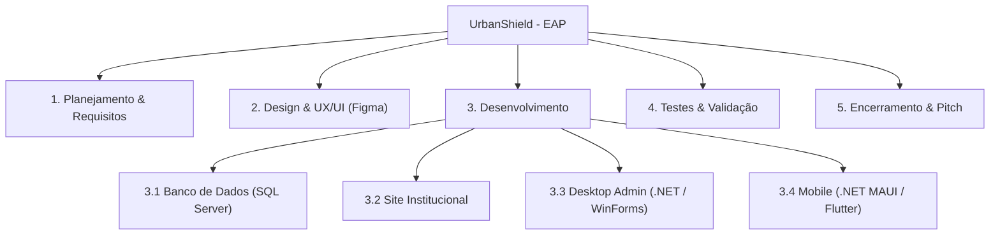
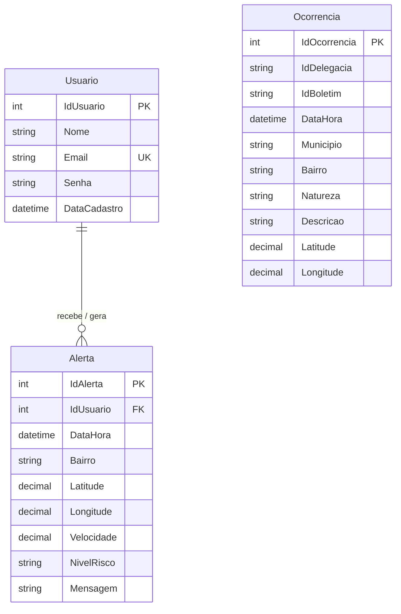
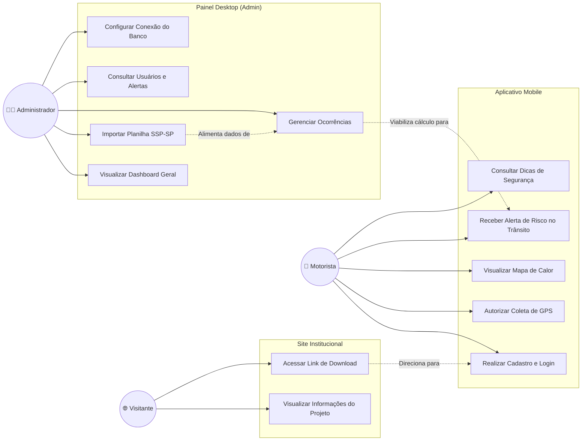
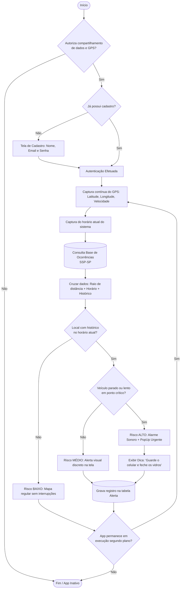

# UrbanShield

**Projeto Integrador — Documento de Definição do Projeto**  
**Aplicativo de Prevenção de Furtos no Trânsito Urbano**  
**Equipe EchoElite — Senac TDS**

---

## Sumário

1. [Briefing](#briefing)
2. [Sobre o Produto](#sobre-o-produto)
3. [Análise de Mercado](#análise-de-mercado)
4. [Objetivos do Projeto](#objetivos-do-projeto)
5. [Justificativa do Projeto](#justificativa-do-projeto)
6. [Definição do Problema](#definição-do-problema)
7. [Requisitos do Aplicativo](#o-que-o-aplicativo-precisa-fazer)
8. [Escopo do Projeto](#o-que-está-incluído-no-projeto)
9. [Como o Aplicativo Funciona](#como-o-aplicativo-funciona)
10. [Metas SMART](#metas-do-projeto--matriz-smart)
11. [Cronograma](#cronograma)
12. [Stakeholders](#quem-está-envolvido-no-projeto)
13. [Riscos](#riscos-do-projeto-e-como-evitá-los)
14. [Orçamento](#estimativa-de-orçamento)
15. [Critérios de Entrega](#quando-o-projeto-estará-pronto)
16. [Tecnologias Utilizadas](#tecnologias-utilizadas)
17. [EAP](#eap--estrutura-do-projeto-por-etapas)
18. [Modelagem e Banco de Dados (3 Tabelas)](#banco-de-dados)
19. [Plataforma 1 — Site Institucional](#plataforma-1--site-institucional)
20. [Plataforma 2 — Desktop (Painel Administrativo)](#plataforma-2--desktop-painel-administrativo)
21. [Plataforma 3 — Mobile (App do Motorista)](#plataforma-3--mobile-app-do-motorista)
22. [Diagramas do Sistema (Casos de Uso e Fluxograma)](#diagramas-do-sistema)
23. [Expansões Futuras](#próximos-passos-e-expansões-futuras)
24. [Por Que o UrbanShield é Diferente](#por-que-o-urbanshield-é-diferente)

---

## Briefing

### Missão

Prevenir e alertar usuários sobre áreas com risco de furto ou roubo em tempo real, permitindo que cada pessoa tome decisões mais seguras no dia a dia.

### Público-Alvo

O UrbanShield é voltado para motoristas e pessoas com acesso a tecnologia que usam o celular enquanto estão no trânsito de grandes cidades como São Paulo. São pessoas que, no dia a dia, passam por semáforos, congestionamentos e vias movimentadas sem saber quais locais possuem maior histórico de furtos naquele horário específico.

### Proposta de Valor

O UrbanShield ajuda motoristas a evitarem furtos através de alertas inteligentes baseados em localização, horário e histórico criminal oficial.

### Personas

**Persona 1 – Quem já foi vítima**  
Carlos tem 34 anos e trabalha como motorista de aplicativo nas noites de São Paulo. A rotina dele é o trânsito: cerca de 8 horas por dia rodando com o smartphone fixado no painel, acompanhando rotas. Numa quinta-feira, às 18h30, Carlos estava parado no semáforo da Avenida Paulista. Em fração de segundos, o vidro foi quebrado e seu celular levado. Carlos não tinha como saber que aquele ponto concentrava dezenas de ocorrências naquele exato horário.  
> *"Eu estava parado lá sem saber de nada. Se alguém tivesse me avisado, eu teria guardado o celular."*

**Persona 2 – Quem se preveniu**  
Joyce utiliza o carro diariamente para se deslocar ao trabalho pela Marginal Tietê no horário de pico. Ciente de assaltos recorrentes em congestionamentos, instalou o UrbanShield. Ao reduzir a velocidade próximo a um semáforo lento, o celular emitiu um aviso sonoro com alerta de risco alto: *"Área de alto risco de furto. Guarde o celular e seus pertences, mantenha os vidros fechados."* Joyce retirou imediatamente o telefone do suporte. Minutos depois, presenciou uma tentativa de abordagem no veículo ao lado.  
> *"O app avisou antes que eu percebesse o perigo. Guardei o celular e não aconteceu nada. Simples assim."*

---

## Sobre o Produto

O UrbanShield cruza em tempo real:
1. **Onde o motorista está agora** (coordenadas GPS)
2. **Que horas são** (janela temporal de risco)
3. **Histórico criminal do local** (dados oficiais da SSP-SP)
4. **Comportamento no trânsito** (parado no semáforo vs. em velocidade regular)

Diferente de mapas estáticos ou apps de trânsito comuns, o UrbanShield age preventivamente de forma proativa apenas quando a probabilidade de risco é real, sem sobrecarregar o motorista com notificações desnecessárias.

### Concorrência

| Aplicativo | Foco Principal | Limitação |
|---|---|---|
| Waze | Trânsito e acidentes | Avisos genéricos, sem foco específico em criminalidade |
| Google Maps | Navegação ponto a ponto | Sem integração com dados de segurança pública |
| SafeApp | Segurança urbana colaborativa | Baixa densidade de dados e atualizações manuais |
| **UrbanShield** | **Prevenção ativa de furtos** | **Especializado em dinâmica de trânsito e dados da SSP-SP** |

---

## Análise de Mercado

O Brasil registrou mais de 800 mil furtos/roubos de aparelhos móveis em 2023, com o Estado de São Paulo concentrando mais de 180 mil casos (Fórum Brasileiro de Segurança Pública e SSP-SP). Esse cenário consolida uma demanda urgente por tecnologias de segurança preventiva na mobilidade urbana e iniciativas de cidades inteligentes (*Smart Cities*).

---

## Objetivos do Projeto

### Objetivo Geral

Desenvolver um ecossistema integrado (Mobile, Desktop e Web) capaz de alertar condutores em tempo real sobre áreas com incidência de roubos e furtos no trânsito urbano.

### Objetivos Específicos

- Monitorar coordenadas via GPS do dispositivo móvel continuamente.
- Processar cruzamento geográfico e temporal com a base da SSP-SP.
- Classificar risco nos níveis: **BAIXO**, **MEDIO** e **ALTO**.
- Emitir alertas sonoros e visuais em caso de risco iminente com o condutor parado ou em lentidão.
- Fornecer ferramenta Desktop administrativa para ingestão dos boletins da SSP-SP e gestão de métricas.
- Disponibilizar site institucional para divulgação e download da aplicação.

---

## Definição do Problema e Justificativa

Relatórios da SSP-SP apontam que subtrações de celulares no trânsito ocorrem de forma padronizada: cruzamentos com semáforo longo, trânsito lento e horários de pico. O motorista não possui acesso prático a esses dados durante a direção. O UrbanShield transforma estatísticas públicas em um assistente de proteção em tempo real.

---

## O Que o Aplicativo Precisa Fazer

### Requisitos Funcionais (RF)

| ID | Descrição |
|---|---|
| RF01 | Coletar coordenadas GPS continuamente no aplicativo mobile. |
| RF02 | Consultar a base de ocorrências filtrando por proximidade e janela de horário. |
| RF03 | Calcular o índice de perigo combinando local, horário e velocidade. |
| RF04 | Categorizar o perigo em níveis: BAIXO, MEDIO e ALTO. |
| RF05 | Disparar notificação visual e sonora em situações de risco ALTO. |
| RF06 | Apresentar mapa dinâmico com identificação visual dos locais de risco. |
| RF07 | Detectar se o condutor está parado (velocidade ≈ 0) em área vulnerável. |
| RF08 | Realizar checagens contínuas em segundo plano sem intervenção manual. |
| RF09 | Exibir recomendações rápidas de proteção ao motorista (ex: fechar vidros, ocultar aparelho). |
| RF10 | *(Desktop)* Importar planilhas oficiais de boletins da SSP-SP. |
| RF11 | *(Desktop)* Gerenciar CRUD de Ocorrências e Usuários. |
| RF12 | *(Desktop)* Exibir dashboard de monitoramento de alertas disparados. |

### Requisitos Não Funcionais (RNF)

| ID | Descrição |
|---|---|
| RNF01 | Conexão com a internet (Wi-Fi ou dados móveis) no dispositivo Android. |
| RNF02 | Permissão de acesso ao GPS de alta precisão ativada pelo usuário. |
| RNF03 | Armazenamento local de zonas de risco para tolerância à queda momentânea de sinal. |
| RNF04 | Interface móvel minimalista para evitar dispersão de atenção do motorista. |
| RNF05 | Banco de dados relacional SQL Server com integridade referencial. |

---

## O Que Está Incluído no Projeto

- **Mobile:** App Android focado no motorista em trânsito com GPS e avisos em tempo real.
- **Desktop:** Software administrativo com controle de ocorrências, importação da SSP-SP e métricas.
- **Site:** Landing page institucional para apresentação pública do produto e conversão de downloads.
- **Banco de Dados:** Modelagem relacional unificada em SQL Server.

---

## Como o Aplicativo Funciona

| Situação Analisada | Retorno no Dispositivo |
|---|---|
| Região sem histórico criminal relevante | Mapa limpo, em segundo plano e sem alertas |
| Região com ocorrências, fora do horário de pico | Aviso discreto em tela (sem emissão sonora) |
| Região de risco no horário de pico, trânsito fluido | Alerta visual moderado de atenção |
| Região com alto índice, horário de pico e veículo parado/lento | **Alerta sonoro contundente + mensagem visual com instruções** |

---

## Metas do Projeto — Matriz SMART

- **S (Específico):** Desenvolver um MVP completo e validado com ao menos 30 usuários condutores.
- **M (Mensurável):** Avaliação superior a 4 estrelas e monitoramento de alertas emitidos via painel.
- **A (Atingível):** Base pública gratuita da SSP-SP e ferramentas .NET / SQL Server sem custos de licença na etapa de desenvolvimento.
- **R (Relevante):** Diminuição direta do índice de celulares subtraídos no trânsito de São Paulo.
- **T (Temporal):** Protótipo funcional nas três plataformas em 12 meses; meta de 5.000 usuários em 6 meses pós-lançamento.

---

## Cronograma e EAP



---

## Banco de Dados

A arquitetura do banco foi consolidada em **3 tabelas**, unificando as coordenadas diretamente nas entidades de evento (`Ocorrencia` e `Alerta`), eliminando redundâncias e acelerando as consultas do sistema.

### DDL — SQL Server

```sql
CREATE DATABASE UrbanShield;
GO

USE UrbanShield;
GO

-- 1. USUARIO
CREATE TABLE Usuario (
    IdUsuario INT IDENTITY(1,1) PRIMARY KEY,
    Nome NVARCHAR(100) NOT NULL,
    Email NVARCHAR(150) NOT NULL UNIQUE,
    Senha NVARCHAR(255) NOT NULL,
    DataCadastro DATETIME2 NOT NULL DEFAULT GETDATE()
);
GO

-- 2. OCORRENCIA (Dados SSP-SP)
CREATE TABLE Ocorrencia (
    IdOcorrencia INT IDENTITY(1,1) PRIMARY KEY,
    IdDelegacia NVARCHAR(50),
    IdBoletim NVARCHAR(50) NOT NULL,            
    DataHora DATETIME2 NOT NULL,
    Municipio NVARCHAR(100) NOT NULL,           
    Bairro NVARCHAR(100) NOT NULL,             
    Natureza NVARCHAR(150) NOT NULL,           
    Descricao NVARCHAR(500),
    Latitude DECIMAL(9,6) NOT NULL,
    Longitude DECIMAL(9,6) NOT NULL
);
GO

-- 3. ALERTA (Registro de notificações emitidas aos motoristas)
CREATE TABLE Alerta (
    IdAlerta INT IDENTITY(1,1) PRIMARY KEY,
    IdUsuario INT NOT NULL,
    DataHora DATETIME2 NOT NULL DEFAULT GETDATE(),
    Bairro NVARCHAR(100) NOT NULL,              
    Latitude DECIMAL(9,6) NOT NULL,
    Longitude DECIMAL(9,6) NOT NULL,
    Velocidade DECIMAL(5,2),
    NivelRisco NVARCHAR(20) NOT NULL,          
    Mensagem NVARCHAR(500),
    CONSTRAINT FK_Alerta_Usuario
        FOREIGN KEY (IdUsuario)
        REFERENCES Usuario(IdUsuario),
    CONSTRAINT CK_Alerta_NivelRisco
        CHECK (NivelRisco IN ('BAIXO', 'MEDIO', 'ALTO'))
);
GO
```

### Diagrama de Entidade-Relacionamento (ER)

Representação fiel da modelagem do projeto:



### Matriz de Uso do Banco por Plataforma

| Tabela | Site | Desktop (Admin) | Mobile (App) |
|---|:---:|:---:|:---:|
| `Usuario` | — | Leitura e Exclusão | Cadastro, Autenticação e Perfil |
| `Ocorrencia` | — | Importação (Excel), CRUD completo | Leitura / Cruzamento em tempo real |
| `Alerta` | — | Visualização analítica no Dashboard | Gravação ao disparar alerta no celular |

---

## Plataforma 1 — Site Institucional

- **Objetivo:** Landing page oficial voltada à conscientização, apresentação dos diferenciais e disponibilização do instalador do aplicativo.
- **Público:** Condutores, parceiros, avaliadores acadêmicos e público em geral.
- **Seções:**
  1. *Hero*: Proposta de valor com chamada para ação (*Download do App*).
  2. *Como Funciona*: Explicação visual do cruzamento de dados.
  3. *Personas*: Depoimentos baseados nos casos de Carlos e Joyce.
  4. *Estatísticas*: Painel estático ilustrando índices de furtos em SP.
  5. *Equipe EchoElite*: Apresentação dos integrantes do projeto Senac TDS.
- **Tecnologias:** HTML5, CSS3 moderno, JavaScript puro; hospedagem no GitHub Pages.

---

## Plataforma 2 — Desktop (Painel Administrativo)

- **Objetivo:** Retaguarda operacional do sistema. É onde os dados oficiais da SSP-SP são processados e onde a saúde dos alertas é fiscalizada.
- **Público:** Administradores do sistema (equipe técnica).
- **Módulos Principais:**
  - **Dashboard:** Contadores (`TotalUsuarios`, `TotalOcorrencias`, `AlertasHoje`) e gráfico de risco.
  - **Módulo de Ocorrências:** Leitura de planilhas Excel da SSP-SP e inserção em lote na tabela `Ocorrencia`.
  - **Módulo de Usuários:** Consulta de contas cadastradas e acompanhamento de alertas vinculados.
  - **Módulo de Alertas:** Histórico de avisos disparados aos motoristas no trânsito.
- **Tecnologia recomendada:** Windows Forms (.NET) com ADO.NET para conexão com o SQL Server.

---

## Plataforma 3 — Mobile (App do Motorista)

- **Objetivo:** Execução contínua em segundo plano enquanto o motorista conduz, emitindo avisos pontuais e assertivos.
- **Público:** Motoristas particulares e de aplicativo (Uber, 99, táxi).
- **Funcionalidades:**
  - Login e autenticação com armazenamento seguro de credenciais.
  - Leitura constante de coordenadas geográficas e velocidade instantânea.
  - Algoritmo de cálculo de risco baseado na proximidade de ocorrências e horário.
  - Alerta sonoro e visual prioritário em situação de risco ALTO com condutor vulnerável.
- **Tecnologia recomendada:** .NET MAUI ou Flutter para plataforma Android.

---

## Diagramas do Sistema

### 1. Diagrama de Casos de Uso (Geral)

Mapeamento de interações entre os atores (**Visitante**, **Motorista** e **Administrador**):



### 2. Fluxograma Completo de Execução

Representação ponta a ponta desde o cadastro até a tomada de decisão do algoritmo de risco:



---

## Próximos Passos e Expansões Futuras

- Algoritmos preditivos de mancha criminal com aprendizado de máquina.
- Relatos colaborativos de incidentes validados pela comunidade de condutores.
- Integração e portabilidade para ecossistema Apple (iOS / CarPlay / Android Auto).
- Parcerias estratégicas com seguradoras e empresas de mobilidade urbana (Uber, 99).

---

## Por Que o UrbanShield é Diferente

> *"O UrbanShield não apenas aponta onde há crimes: ele analisa quando, onde e em qual velocidade o motorista se encontra para protegê-lo antes da abordagem criminosa."*

O sistema atua com precisão cirúrgica no momento em que o condutor está mais frágil — parado em semáforos ou lentidões de vias expressas com aparelho à mostra —, unindo dados governamentais com geolocalização ativa para salvar bens e vidas.
